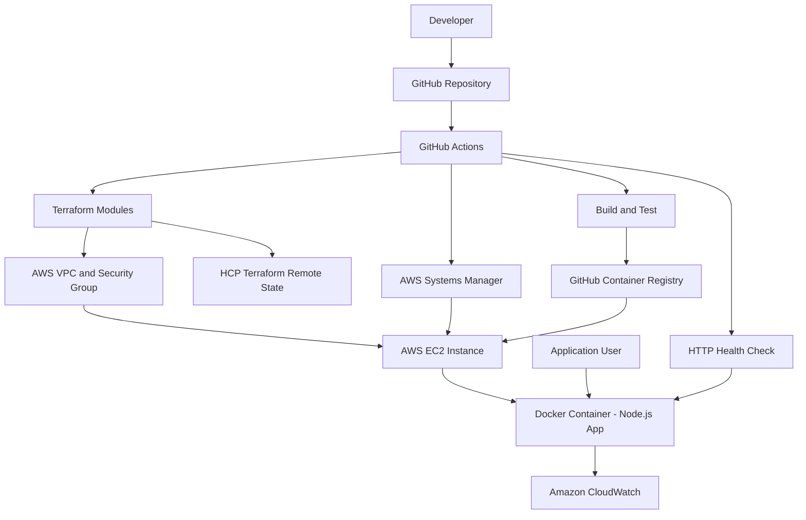

# 🚀 DevOps Practical Challenge

**Automated deployment of a Dockerized Node.js application to AWS EC2 using Terraform and GitHub Actions.**

[](https://github.com/Kelkaal/devops-exc/actions/workflows/deploy.yml)


## ✨ Overview

This project demonstrates a repeatable, automated AWS deployment: GitHub Actions tests the application, publishes a Docker image to GitHub Container Registry (GHCR), provisions infrastructure with modular Terraform, deploys through AWS Systems Manager (SSM), and checks application health.

| Component | Technology |
|---|---|
| Application | Node.js, HTTP `GET /health` on port `3000` |
| Infrastructure | Terraform modules: `vpc`, `ec2`, `monitoring` |
| Cloud | AWS EC2, VPC, IAM, SSM, CloudWatch (`us-east-1`) |
| Container registry | GHCR — `ghcr.io/kelkaal/devops-exc` |
| CI/CD | GitHub Actions |
| Terraform state | HCP Terraform remote workspace |

## 🏗️ Architecture



## ⚙️ CI/CD

On a **push to `main`**, `.github/workflows/deploy.yml`:

1. Installs dependencies and runs application tests.
2. Builds and publishes a commit-SHA-tagged Docker image to GHCR.
3. Runs Terraform `init`, `validate`, `plan`, and `apply`.
4. Uses AWS SSM to pull and start that exact image on EC2.
5. Checks `GET /health` to confirm the application responds.

Pull requests run validation/testing; deployment is restricted to pushes to `main`. Although the workflow also has a manual trigger, its deployment job is currently push-only.

## 📁 Repository

```text
.
├── .github/workflows/
│   ├── deploy.yml        # Build, test and deploy
│   └── destroy.yml       # Manually triggered infrastructure teardown
├── app/                  # Node.js application and tests
├── terraform/
│   ├── modules/
│   │   ├── vpc/
│   │   ├── ec2/
│   │   └── monitoring/
│   └── environments/prod/
└── README.md
```

## 🚀 Deployment

**Prerequisites:** An AWS account with appropriate permissions, an HCP Terraform workspace/token, and GitHub repository Actions enabled.

Configure these GitHub Actions secrets (never commit their values):

| Secret | Purpose |
|---|---|
| `AWS_ACCESS_KEY_ID` | AWS authentication |
| `AWS_SECRET_ACCESS_KEY` | AWS authentication |
| `TF_API_TOKEN` | HCP Terraform access |
| `EC2_SSH_PUBLIC_KEY` | Public SSH key for the EC2 key pair |

Then push to `main`:

```bash
git clone https://github.com/Kelkaal/devops-exc.git
cd devops-exc
git push origin main
```

> [!NOTE]
> A push triggers deployment **only when it contains a new commit**. Check progress under [GitHub Actions](https://github.com/Kelkaal/devops-exc/actions). AWS/HCP settings and permissions must match the Terraform configuration. To make a change, commit it and push to `main`.

After a successful run, use the URL shown in the workflow output and visit `/health`. EC2 public IPs may change after instance replacement. Infrastructure teardown is defined in `.github/workflows/destroy.yml` and should be used cautiously.

## 📊 Monitoring & verification

- **CloudWatch alarms:** High EC2 CPU usage and failed EC2 status checks.
- **Application logs:** CloudWatch log group and Docker `awslogs` configuration are included; successful log ingestion has **been independently verified**.
- **Deployment evidence:** GitHub Actions deployment succeeded; SSM returned success, Terraform reused the existing EC2 instance, and the `/health` endpoint responded successfully.

## 🧠 Design decisions

| Choice | Reason |
|---|---|
| Modular Terraform | Reusable, maintainable infrastructure definitions |
| EC2 + Docker | Simple hosting suitable for the scope of this exercise |
| Commit-SHA image tags | Deploy a specific, traceable build |
| AWS SSM | Run deployment commands without relying on SSH for CI/CD |
| HCP Terraform state | Centralized state across workflow runs |


---

**Source:** [GitHub repository](https://github.com/Kelkaal/devops-exc) · **Pipeline:** [GitHub Actions](https://github.com/Kelkaal/devops-exc/actions)
